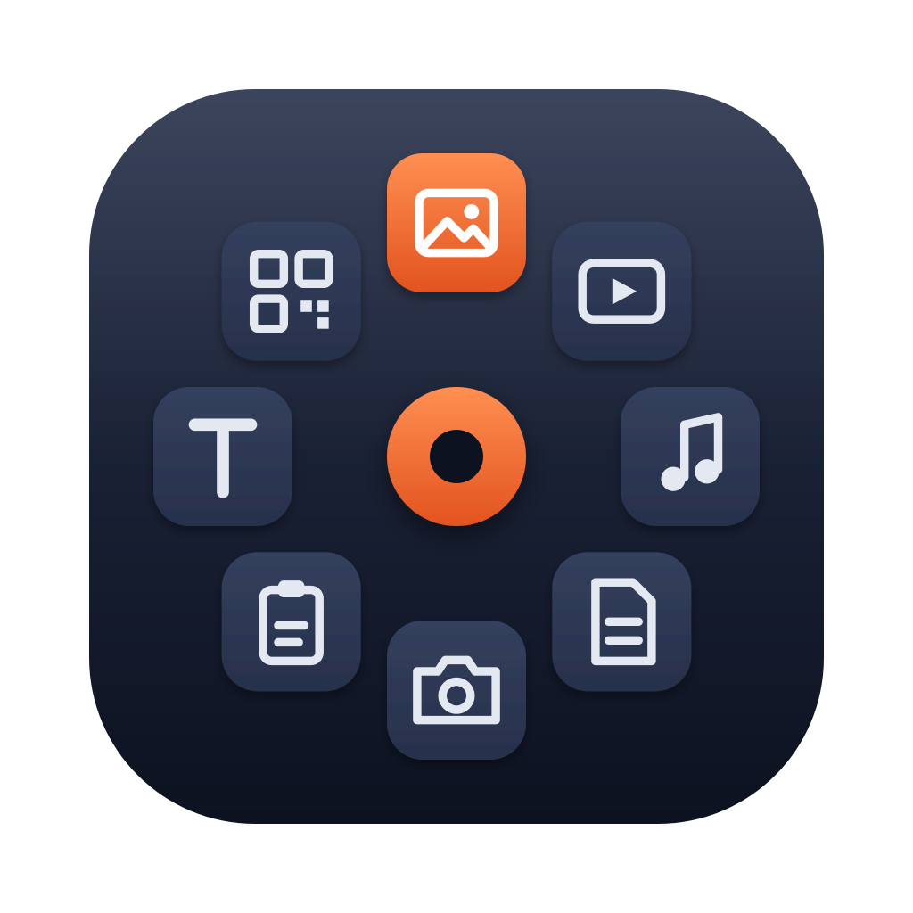
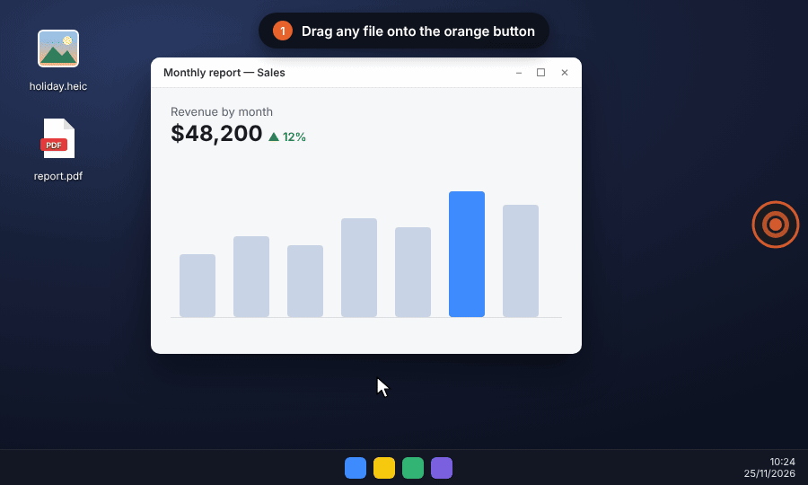

<h1 align="center">
   
  Desk Wheel
</h1>

<b>Drop it. Turn it. Done.</b> 
Free, offline file tools at your pointer, for Windows and macOS.

  
  
  
  
  

  

Drag a file onto the orange button at the edge of your screen and drop it on what you want: **JPG, PDF, MP4, Compress, Merge…** The result is saved beside the original, which is never changed. Click the button instead for **screenshots with mark-up, copying text from the screen, colour picking, screen recording and clipboard history**. Everything runs on your computer: no uploads, no account, no limits.

## Contents

- [Features](#features)
- [Download](#download)
- [Getting started](#getting-started)
- [Keyboard shortcuts](#keyboard-shortcuts)
- [What's on each wheel](#whats-on-each-wheel)
- [Privacy](#privacy)
- [Updates](#updates)
- [Documentation](#documentation)
- [Support](#support)
- [Contributing](#contributing)
- [Licence](#licence)
- [Acknowledgements](#acknowledgements)

## Features

- **Convert by dropping:** images (PNG, JPG, WebP, AVIF, HEIC, ICO, TIFF, GIF), video and audio (MP4, WebM, GIF, MP3, M4A, WAV, FLAC), PDF pages to images or text, Word, Excel and PowerPoint to PDF, archives and subtitles.
- **Screenshots with mark-up:** area, window or full screen, then pen, arrows, boxes, highlights, text, numbered steps, blur and redact, right where you captured. Copy, save, pin it on screen or open it in the editor.
- **Editor with Beautify:** crop and annotate any image, and put screenshots on a colourful background, ready for posts and slides.
- **Text from anything on screen (OCR):** drag over a video, an image or a locked PDF and its text is copied, in English and Arabic.
- **Clipboard history:** everything you copied, searchable, with pins. Copies that password managers mark as private are never kept.
- **Screen tools:** record part of the screen as MP4, pick any colour, read QR codes and barcodes, and make QR codes.
- **Searchable PDFs (OCR):** scanned PDFs get their words as invisible text, so they can be searched and copied while looking the same. English and Arabic, on your computer.
- **PDF tools:** merge, split, keep, reorder or delete pages, rotate, page numbers, watermark, compress, grey and flattened copies, pull out the pictures, remove hidden details, and add or remove passwords (AES-256).
- **Picture tools:** resize, compress, square crop, flip, black and white, watermark (Arabic too), combine into a row, column or grid, remove photo location data (EXIF), cut out backgrounds (Mac), app icon and website favicon sets, and copy as Base64.
- **Media player:** every format with subtitles, speed, equalizer, A-B repeat and playlists. Its engine (VLC by VideoLAN, 31–48 MB) downloads only when you first play something and say yes.
- **Disk space:** a list and ring chart of what's taking up space, with Largest files; open, show, rename, ZIP or move items to the Trash / Recycle Bin, or collect them from several folders and remove them together.
- **Video and audio editing:** trim to the second, join clips, speed up or slow down (voices keep their pitch), rotate, flip, 720p and 1080p copies, a thumbnail sheet of 16 frames, and subtitles added as a track or burned into the picture (Arabic too).
- **Archives, like WinRAR:** open RAR, 7z, ZIP, TAR, TAR.GZ / BZ2 / XZ, GZ, BZ2, XZ and ISO, password-protected ones too; make ZIP (optionally with an AES-256 password) and TAR.GZ. Harmful archives that try to write outside their folder are refused.
- **File and text tools:** SHA-256 and MD5 checksums, word counts, join text or CSV files, CSV to JSON, remove hidden details from Word, Excel and PowerPoint files, and bulk rename with undo.
- **Watched folders:** files arriving in a folder are converted automatically, for example every image to WebP.
- **Picture viewer:** Next and Back through every picture in a folder with the arrow keys, zoom, full screen, and *Open with › Desk Wheel* in File Explorer.
- **Markdown and JSON readers:** `.md` files as a clean, GitHub-style page; `.json` files as a coloured, foldable, searchable tree, plus Format, Minify and JSON → CSV.
- **Safe by design:** originals are never changed or overwritten, and nothing leaves your computer.
- **Light and dark themes** that follow your system, and **signed automatic updates**.

## Download

| System | Download | |
| --- | --- | --- |
| **Windows 10 (1809+) / 11** | [Microsoft Store](https://apps.microsoft.com/detail/9PF534B6ZW4Z) | Recommended once published: trusted by Windows, updates automatically |
| Windows 10 / 11, Intel or AMD (x64) | [Installer (`…-win-x64-setup.exe`)](https://github.com/irfanaslam-io/desk-wheel/releases/latest) | Installs for you only, no administrator needed |
| Windows 11 on Arm | [Installer (`…-win-arm64-setup.exe`)](https://github.com/irfanaslam-io/desk-wheel/releases/latest) | For Snapdragon PCs |
| **macOS 12 or later**, Apple silicon | [Disk image (`…-mac-arm64.dmg`)](https://github.com/irfanaslam-io/desk-wheel/releases/latest) | Open it and drag Desk Wheel to Applications |

- **Windows installer:** it isn't code-signed yet, so Windows may show a SmartScreen warning (*More info › Run anyway*) or Smart App Control may block it. The Microsoft Store version has no warnings.
- **Mac:** the first time, macOS says it can't check Desk Wheel. Open *System Settings › Privacy & Security* and click *Open Anyway*. You only do this once.
- Nothing else to install: the video and audio engine (FFmpeg) is included. For Office files, Desk Wheel uses Microsoft Office if you have it, or the free LibreOffice.

Every release lists the SHA-256 of each file so you can check your download.

## Getting started

1. **Install and open Desk Wheel.** An orange button appears at the right edge of your screen, and an orange ring in the menu bar (Mac) or system tray (Windows).
2. **Drag a file onto the button.** The wheel opens around it. Keep dragging onto what you want, such as **JPG**, and let go. A card in the corner says when it's done; click it to show the result.
3. **Or click the button.** The **Screenshot** wheel opens: Area, Window, Full, Scroll (scrolling screenshot), Text, Clipboard, Record and more. Click the **centre** to step through **Screenshot → Convert → Tools → Actions**; Convert, Tools and Actions work on the files selected in File Explorer or Finder.
4. **Select a folder** to work on every file inside it, for example all its photos to WebP.
5. **Right-click a segment** to pin it to the front of its wheel, and **drag the button** to move it anywhere.

The [user guide](docs/USER-GUIDE.md) covers every tool in detail.

## Keyboard shortcuts

| Action | Windows | Mac |
| --- | --- | --- |
| Open the wheel at the pointer | Ctrl+Shift+Space | ⌥ Space |
| Screenshot: area | Alt+Shift+1 | ⌥⇧1 |
| Screenshot: window | Alt+Shift+2 | ⌥⇧2 |
| Screenshot: full screen | Alt+Shift+3 | ⌥⇧3 |
| Clipboard history | Alt+Shift+V | ⌥⇧V |
| Close the wheel | Esc | Esc |

**While marking up a screenshot:** Pen `P`, Line `L`, Arrow `A`, Box `R`, Circle `C`, Highlight `H`, Text `T`, Steps `N`, Blur `B`, Redact `X`, Move `M`. Colours `1`–`7`, the mouse wheel sets the thickness, `Ctrl+Z` / `Ctrl+Y` undo and redo. Finish with `Enter` (save), `Ctrl+C` (copy and save), `Ctrl+S` (save), `Ctrl+P` (pin on screen) or `Ctrl+E` (open in the editor). `Esc` cancels. On a Mac, use ⌘ for Ctrl.

## What's on each wheel

| Wheel | What's on it |
| --- | --- |
| **Screenshot** | Area, Window, Full, Scroll, Text, Clipboard, Record, then **More ›** for GIF, Colour, Ruler, QR, Make QR, 5 s and 10 s timers, Files, History, Disk and Settings |
| **Convert** | Images: PNG, JPG, WebP, HEIC (Mac), AVIF, ICO, TIFF, GIF, BMP · PDF → PNG, JPG, TXT · Video: MP4, WebM, MKV, MOV, GIF, MP3, M4A · Audio: MP3, M4A, WAV, FLAC, OGG, Opus · Office: PDF, DOCX, XLSX, PPTX, CSV · RAR, 7z, ZIP, TAR.*, ISO → Extract, ZIP, TAR.GZ · CSV → JSON · SRT ↔ VTT · Markdown: Read, HTML · JSON: View, Format, Minify, CSV, HTML |
| **Tools** | Images: Compress, 50%, Size…, Rotate, No EXIF, View, Edit, Square, Flip, Grey, Watermark…, Text, Cut out, Icons, Favicon, PDF · several images: Row, Column, Grid · PDF: Merge, Pages…, Delete…, Rotate, Compress, Searchable, Watermark…, Lock, Unlock, Split, Numbers, Images, Grey, Flatten, Clean · Video: Trim…, Compress, 50%, Mute, Frame, Join, Speed…, Rotate, Flip, 720p, 1080p, Sheet, Subtitles, Burn in · Audio: Trim…, Join, Speed…, Normalize, Mono, Compress · Rename, ZIP |
| **Actions** | Copy files, Copy image, Copy path, Copy name, Open terminal here, Reveal, Copy to Desktop, Checksum, Base64 (pictures) |

Only the choices that fit the files you're dragging are shown. Wheels with more than eight choices have a **More ›** segment.

## Privacy

- Your files, screenshots and clipboard **never leave your computer**. Conversions, text recognition and everything else run locally.
- Desk Wheel asks once whether it may send **anonymous usage counts** (which tools and screens are used, the app version and the system). No file names, paths or content, ever. You can change your answer any time in *Settings › Privacy*.
- Read the full [privacy policy](https://irfanaslam.io/desk-wheel/privacy).

## Updates

Desk Wheel checks for a new version at most twice a day and asks before installing. Updates install over the current version: nothing to uninstall, and your settings, history and clipboard are kept. Every update is signed, and Desk Wheel refuses one that isn't. The Microsoft Store version is updated by the Store. To check now, choose *Check for updates…* in the menu.

## Documentation

| | |
| --- | --- |
| [User guide](docs/USER-GUIDE.md) | Every tool, setting and wheel in detail, plus known limits |
| [Building and testing](docs/BUILDING.md) | Build from source on Windows and macOS, architecture and the test checklist |
| [Releasing](docs/RELEASING.md) | Signing, the Microsoft Store, publishing releases and updates, usage statistics |
| [Store listing](docs/STORE-LISTING.md) | Everything to paste into Partner Center for a Microsoft Store submission |
| [Privacy policy](https://irfanaslam.io/desk-wheel/privacy) | What is and isn't sent |
| [Security policy](SECURITY.md) | How to report a vulnerability |

## Support

- **Questions and problems:** [open an issue](https://github.com/irfanaslam-io/desk-wheel/issues/new/choose) or email [hello@irfanaslam.io](mailto:hello@irfanaslam.io).
- **Security issues:** please report privately, as described in [SECURITY.md](SECURITY.md).
- **Commercial licences** for larger companies: see [COMMERCIAL.md](COMMERCIAL.md).

## Contributing

Bug reports, ideas and pull requests are welcome. Please read [CONTRIBUTING.md](CONTRIBUTING.md) and the [Code of Conduct](CODE_OF_CONDUCT.md) first. To build Desk Wheel yourself, see [docs/BUILDING.md](docs/BUILDING.md).

## Licence

Desk Wheel is **free for individuals and small businesses**, under your choice of the [PolyForm Small Business](LICENSES/PolyForm-Small-Business-1.0.0.md) or [PolyForm Noncommercial](LICENSES/PolyForm-Noncommercial-1.0.0.md) License 1.0.0 (summary in [LICENSE.md](LICENSE.md)):

- **Free:** personal use; freelancers and companies with **fewer than 100 people and under US$1 million** revenue a year; and charities, schools, universities, public research and health organisations and government institutions of any size. You may read, change and share the code too.
- **Larger companies** need a commercial licence: see [COMMERCIAL.md](COMMERCIAL.md) or write to hello@irfanaslam.io.
- Because it limits use by larger companies, Desk Wheel is "source-available" rather than "open source" in the OSI sense.

Copyright © 2026 Muhammad Irfan Aslam ([irfanaslam.io](https://irfanaslam.io)).

## Acknowledgements

Desk Wheel is built with [Avalonia](https://avaloniaui.net) and [SkiaSharp](https://github.com/mono/SkiaSharp), and includes an **LGPL** build of [FFmpeg](https://ffmpeg.org) (no GPL or nonfree parts; its licence and source details ship beside it), [PDFium](https://pdfium.googlesource.com/pdfium/), [PDFsharp](https://www.pdfsharp.com), [ZXing.Net](https://github.com/micjahn/ZXing.Net), and marked, DOMPurify, highlight.js and GitHub's Markdown CSS for the Markdown reader. H.264 video uses the system's own encoder, so no x264 (GPL) is needed. LibreOffice isn't shipped. See [THIRD-PARTY-NOTICES.md](THIRD-PARTY-NOTICES.md) for every licence.

---

Powered by <a href="https://irfanaslam.io">irfanaslam.io</a> · Support: <a href="mailto:hello@irfanaslam.io">hello@irfanaslam.io</a>

